# Gaddong(가똥) — 실적 시즌 리서치 데스크

미국·한국 상장사의 **분기 실적을 한 화면에서 정리**하는 로컬 대시보드입니다.
종목과 분기를 고르면 아래 9가지를 자동으로 모으고, 자동으로 못 채우는 값은 직접 넣거나 AI(Claude 구독 플랜)로 추출합니다.

| # | 항목 | 어디서 오나 |
|---|---|---|
| 1 | 매출액·영업이익·EBITDA·EPS의 QoQ / YoY | 자동 (yfinance · DART · SEC 원본 · 네이버). 한국 EBITDA는 DART 주석의 감가상각비로 계산 |
| 2 | 컨센서스 대비 서프라이즈 / 쇼크 | 자동 (yfinance · Alpha Vantage · 스냅샷 · MarketBeat 옵트인) + 직접 입력 |
| 3 | 사업부문별 매출·영업이익 (QoQ/YoY) | **자동 (SEC 10-Q/10-K · DART 정기보고서 XBRL 원본)** + AI 추출 + 직접 입력 |
| 4 | 기업별 KPI 변화 | AI 추출 + 직접 입력 |
| 5 | 전분기 대비 컨콜 톤 변화 | AI 분석 (+ Alpha Vantage 감성 점수) |
| 6 | 가이던스 | AI 추출 + 직접 입력 |
| 7 | Q&A · CEO 핵심 발언 | AI 분석 |
| 8 | 앞으로의 카탈리스트(체크포인트) | 자동(다음 발표일·공시) + AI + 직접 입력 |
| 9 | 주가 반응 (갭·D+1·D+5·D+20·시장 대비) | 자동 (yfinance, 한국은 KRX 공식 시세로 빈 날 보완) |

<p align="center">
  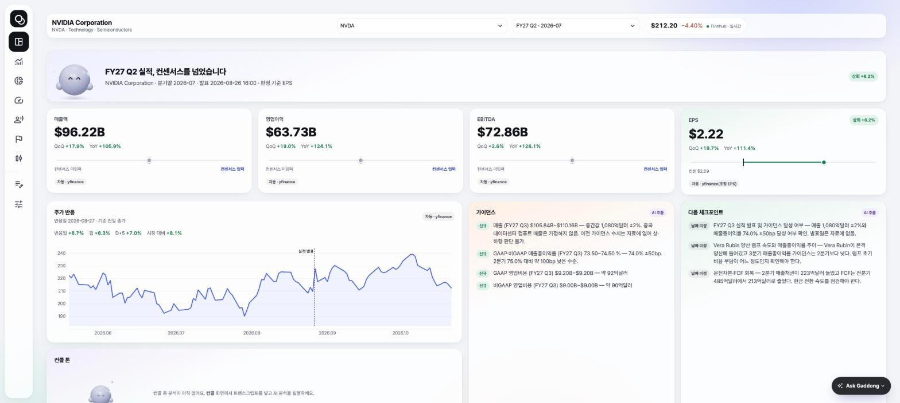
  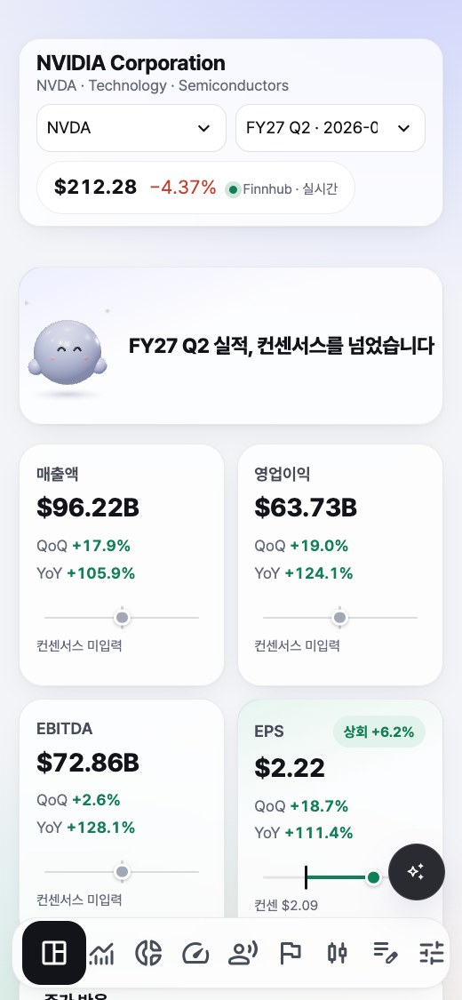
</p>

<p align="center">
  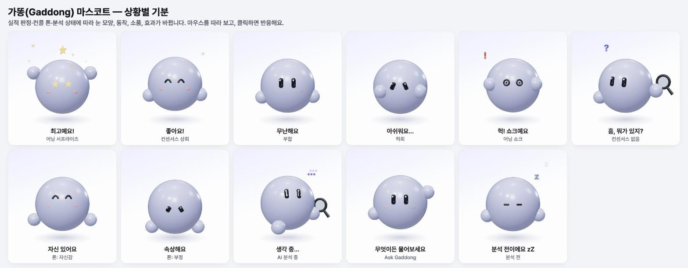
</p>

**가똥 마스코트**: 화면 곳곳의 오브 캐릭터가 실적 판정(서프라이즈·상회·부합·하회·쇼크), 컨콜 톤, 분석 상태에 맞춰 표정과 동작을 바꿉니다. 마우스를 따라 보고, 클릭하면 반응해요. → [2-17. 가똥 마스코트](#2-17-가똥-마스코트-3d-캐릭터)

- **주소는 고정입니다: <http://127.0.0.1:8765>**
- 유료 API는 하나도 쓰지 않습니다. 키가 하나도 없어도 1·2(EPS)·9번은 바로 동작합니다.
- AI는 **Claude 구독 플랜**(Pro/Max)을 씁니다. API 키는 필요 없습니다.

> ⚠️ 이 도구는 투자 자문이 아닙니다. 모든 숫자에는 출처 배지(자동 / 내 입력 / AI 추출)가 붙어 있으니, 공유하기 전에 원문으로 확인하세요.

---

## 목차

1. [완전 초보자용 설치 가이드](#1-완전-초보자용-설치-가이드)
   - 1-1. Antigravity 설치
   - 1-2. 터미널 여는 법
   - 1-3. 필수 CLI 설치 (Git · Python · Claude Code)
   - 1-4. 이 저장소 내려받기
   - 1-5. 실행하기
   - 1-6. API 키 등록 (.env)
2. [화면 사용법 (상세)](#2-화면-사용법-상세)
   - [2-1. 처음 5분 따라하기](#2-1-처음-5분-따라하기-키-없이) · [2-2. 화면 구성](#2-2-화면-구성-모든-화면-공통) · [2-3. 표시 읽는 법](#2-3-공통으로-보이는-표시-읽는-법)
   - 화면별: [개요](#2-4-개요) · [실적](#2-5-실적) · [사업부문](#2-6-사업부문) · [KPI](#2-7-kpi) · [컨콜 결과](#2-8-컨콜--분석-결과-탭) · [컨콜 원문·AI](#2-9-컨콜--원문--ai-실행-탭) · [가이던스](#2-10-가이던스--카탈리스트) · [주가 반응](#2-11-주가-반응) · [입력 관리](#2-13-입력-관리) · [설정](#2-14-설정) · [Ask Gaddong](#2-15-ask-gaddong-ai-질문) · [가똥 마스코트](#2-17-가똥-마스코트-3d-캐릭터)
   - [2-12. 실적 발표 당일 순서](#2-12-실적-발표-당일-순서-처음부터-끝까지)
3. [내가 직접 해야 하는 일 vs 자동으로 되는 일](#3-내가-직접-해야-하는-일-vs-자동으로-되는-일)
   - [3-3. 키를 넣으면 화면이 어떻게 달라지나](#3-3-키를-넣으면-화면이-어떻게-달라지나) · [3-4. my_inputs 작성 완전 가이드](#3-4-my_inputs-작성-완전-가이드)
4. [필요한 API와 등록 방법](#4-필요한-api와-등록-방법)
5. [보안 기본 규칙](#5-보안-기본-규칙)
6. [밖에서 접속하기: Tailscale 터널](#6-밖에서-접속하기-tailscale-터널)
7. [폴더 구조](#7-폴더-구조)
8. [문제 해결 (FAQ)](#8-문제-해결-faq)
9. [개발자용 메모](#9-개발자용-메모)

---

## 1. 완전 초보자용 설치 가이드

처음이라면 아래 순서대로만 따라오세요. 전체 15~25분 정도 걸립니다.
명령어는 `코드 상자` 안의 내용을 **그대로 복사해서 붙여넣고 Enter**를 누르면 됩니다.

### 1-1. Antigravity 설치 (코드 편집기)

[Google Antigravity](https://antigravity.google)는 AI가 들어간 코드 편집기입니다(VS Code 기반). 이 프로젝트를 열고, 파일을 고치고, 터미널을 쓰는 데 사용합니다.

1. 브라우저에서 **<https://antigravity.google/download>** 에 접속합니다.
2. 내 컴퓨터에 맞는 설치 파일을 받습니다. 페이지가 자동으로 맞는 버전을 추천해 줍니다.
   - **Mac**: Apple 칩(M1~M4)이면 *Apple Silicon*, 그 외는 *Intel*. 모르겠으면 화면 왼쪽 위 사과 메뉴 → *이 Mac에 관하여*에서 "칩"을 확인하세요.
   - **Windows**: 대부분 *x64*를 고르면 됩니다.
3. 설치합니다.
   - **Mac**: 받은 `.dmg`를 열고 Antigravity 아이콘을 *Applications* 폴더로 끌어다 놓습니다.
   - **Windows**: 받은 `.exe`를 실행하고 *다음*을 눌러 설치합니다.
4. Antigravity를 실행하고 **Google 계정으로 로그인**합니다. 로그인해야 쓸 수 있습니다.
5. 처음 설정 화면이 나오면 기본값 그대로 *Next*를 눌러도 됩니다.

> 💡 Antigravity 대신 VS Code나 Cursor를 써도 아래 과정은 똑같습니다.

### 1-2. 터미널 여는 법

명령어를 입력하는 창을 **터미널**이라고 합니다.

- **Antigravity 안에서**: 상단 메뉴 **Terminal → New Terminal** (단축키 Mac `` Ctrl+` `` / Windows `` Ctrl+` ``)
- **Mac 단독**: `Cmd + Space` → "터미널" 입력 → Enter
- **Windows 단독**: 시작 버튼 → "PowerShell" 입력 → *Windows PowerShell* 실행

> Windows에서는 이 문서의 명령을 **PowerShell**에서 실행하세요(명령 프롬프트 CMD 아님).

### 1-3. 필수 CLI 설치

세 가지가 필요합니다: **Git**(코드 내려받기), **Python 3.11 이상**(앱 실행), **Claude Code CLI**(AI 기능).

#### ① Git

**Mac**

```bash
git --version
```

버전이 나오면 이미 설치된 것입니다. "command line developer tools" 설치 창이 뜨면 *설치*를 누르고 끝날 때까지 기다린 뒤 다시 실행하세요.

**Windows** — <https://git-scm.com/download/win> 에서 받아 기본값으로 설치합니다. 설치 후 **PowerShell을 새로 열고** 확인합니다.

```powershell
git --version
```

#### ② Python 3.11 이상

**Mac** — <https://www.python.org/downloads/> 에서 최신 macOS 설치 파일을 받아 설치합니다. 확인:

```bash
python3 --version
```

`Python 3.11` 이상이면 됩니다(3.12, 3.13, 3.14 모두 OK).

**Windows** — <https://www.python.org/downloads/> 에서 받아 설치합니다.
⚠️ 설치 첫 화면 아래쪽 **"Add python.exe to PATH"를 반드시 체크**하세요. 확인:

```powershell
py --version
```

#### ③ Claude Code CLI (AI 기능용, Claude 구독 플랜 필요)

AI 분석(컨콜 톤, 핵심 발언, 세그먼트·가이던스 추출, Ask Gaddong)은 내 컴퓨터의 Claude Code CLI를 통해 **Claude 구독 플랜**(Pro 또는 Max)으로 동작합니다. AI를 안 쓸 거라면 건너뛰어도 앱은 동작합니다.

**Mac / Linux**

```bash
curl -fsSL https://claude.ai/install.sh | bash
```

**Windows (PowerShell)**

```powershell
irm https://claude.ai/install.ps1 | iex
```

설치가 끝나면 **터미널을 닫았다가 새로 열고** 로그인합니다.

```bash
claude
```

처음 실행하면 브라우저가 열립니다. **Claude 구독 계정(claude.ai)으로 로그인**하세요. 로그인이 끝나면 터미널에서 `/exit`를 입력해 나옵니다. 설치 상태는 다음 명령으로 점검할 수 있습니다.

```bash
claude doctor
```

> ⚠️ 셸에 `ANTHROPIC_API_KEY` 환경변수가 설정돼 있으면 Claude Code가 플랜 대신 API 과금을 쓸 수 있습니다. 이 앱은 AI를 호출할 때 그 변수를 자동으로 지워서 **항상 플랜으로** 동작하게 합니다.

### 1-4. 이 저장소 내려받기

원하는 폴더(예: 문서 폴더)에서 실행합니다.

```bash
cd ~/Documents
git clone https://github.com/djfksjd/gaddong.git
cd gaddong
```

Windows PowerShell에서는 `cd ~/Documents` 대신 `cd $HOME\Documents`를 씁니다.

그다음 Antigravity에서 **File → Open Folder** → 방금 받은 `gaddong` 폴더를 엽니다.

### 1-5. 실행하기

Antigravity의 터미널(1-2 참고)에서 실행합니다.

**Mac / Linux**

```bash
./run.sh
```

**Windows (PowerShell)**

```powershell
.\run.bat
```

처음 실행하면 스크립트가 아래 일을 자동으로 합니다.

1. `.venv` 가상환경을 만듭니다. 이 프로젝트 전용 파이썬 공간이라 컴퓨터의 다른 프로그램에 영향을 주지 않습니다.
2. `requirements.txt`의 패키지를 설치합니다(1~3분).
3. `.env.example`을 복사해 `.env`를 만듭니다. API 키를 넣는 파일입니다.
4. 앱을 실행하고 브라우저에서 **<http://127.0.0.1:8765>** 를 엽니다.

브라우저가 자동으로 안 열리면 주소창에 직접 `http://127.0.0.1:8765`를 입력하세요.
**종료**는 터미널에서 `Ctrl + C`입니다. 다음부터는 `./run.sh`(Windows `.\run.bat`)만 실행하면 바로 뜹니다.

<details>
<summary>스크립트 없이 직접 실행하고 싶다면 (펼치기)</summary>

```bash
python3 -m venv .venv
source .venv/bin/activate          # Windows: .venv\Scripts\activate
pip install -r requirements.txt
cp .env.example .env               # Windows: copy .env.example .env
streamlit run app.py
```

</details>

> 🔒 `Permission denied`가 나오면(Mac): `chmod +x run.sh` 후 다시 실행하세요.
> 🔒 Windows에서 "스크립트 실행이 비활성화"되어 있다는 오류가 나오면 `.\run.bat` 대신 `cmd /c run.bat`을 실행하세요.

### 1-6. API 키 등록 (.env)

키가 하나도 없어도 앱은 동작합니다. 키를 넣을수록 채워지는 칸이 늘어납니다. 모두 **무료**입니다.

1. Antigravity 왼쪽 파일 목록에서 **`.env`** 파일을 엽니다. 안 보이면 `.env.example`을 복사해 이름을 `.env`로 바꾸세요.
2. 아래 [4장](#4-필요한-api와-등록-방법)을 보고 원하는 키를 받아 `=` 뒤에 붙여넣습니다.

```dotenv
SEC_USER_AGENT=Hong Gildong hong@example.com
ALPHAVANTAGE_API_KEY=여기에_키
DART_API_KEY=여기에_키
```

3. 저장한 뒤 앱을 **껐다가(Ctrl+C) 다시 실행**합니다.
4. 앱 왼쪽 레일 맨 아래 **설정** 아이콘에서 각 키가 "등록됨"인지 확인합니다. 키 값 자체는 화면에 나오지 않습니다.

키마다 화면의 어떤 칸이 채워지는지는 [3-3. 키를 넣으면 화면이 어떻게 달라지나](#3-3-키를-넣으면-화면이-어떻게-달라지나)에 표로 정리했습니다.

> ❗ `.env`는 절대 다른 사람에게 보내거나 GitHub에 올리지 마세요. 이 저장소는 `.gitignore`로 `.env`를 자동으로 제외합니다.

---

## 2. 화면 사용법 (상세)

> 아래 캡처는 모두 엔비디아(`NVDA`) FY27 2분기 화면입니다. **키를 하나도 넣지 않은 상태**에서 보도자료 AI 추출만 한 번 실행했습니다. 그래서 일부 칸은 비어 있습니다.

### 2-1. 처음 5분 따라하기 (키 없이)

1. 앱을 실행하고(1-5) 브라우저에서 <http://127.0.0.1:8765> 를 엽니다.
2. 처음에는 예시 관심 종목(NVDA, AAPL, 005930.KS, 000660.KS)의 첫 종목이 열립니다.
3. 위쪽 **종목 상자**를 누르고 보고 싶은 티커를 입력한 뒤 Enter를 누릅니다.
4. **분기 상자**에서 분기를 고릅니다. 기본값은 가장 최근 발표 분기입니다.
5. **개요**에서 판정 문장과 4대 지표 카드를 봅니다. 여기까지는 키도 입력도 필요 없습니다.
6. 더 채우고 싶으면 [2-12 실적 발표 당일 순서](#2-12-실적-발표-당일-순서-처음부터-끝까지)를 따라 하세요.

> 💡 `my_inputs/` 폴더에는 **처음에 아무것도 넣지 않아도 됩니다.** 필요한 폴더와 파일은 앱이 저장할 때 알아서 만듭니다.

### 2-2. 화면 구성 (모든 화면 공통)

| 위치 | 이름 | 하는 일 |
|---|---|---|
| 왼쪽 세로 막대 | **아이콘 레일** | 화면 이동. 아이콘에 마우스를 올리면 이름이 나옵니다. 지금 보고 있는 화면은 검은 칸으로 표시됩니다. |
| 위쪽 가로 막대 | **상단 바** | 회사 이름·업종, 종목 상자, 분기 상자, 실시간 가격 |
| 오른쪽 아래 | **Ask Gaddong** | AI에게 질문하는 버튼 |
| 상단 바 아래 | 노란 경고 문구 | 데이터를 일부 못 가져왔을 때 이유가 나옵니다(예: 키 미등록, 일시 차단). |

**아이콘 레일 순서** (위에서 아래로)

| 순서 | 화면 | 다루는 항목 |
|---|---|---|
| 1 | 개요 | 전체 요약 |
| 2 | 실적 | ① 실적 QoQ·YoY, ② 컨센서스 대비 |
| 3 | 사업부문 | ③ 세그먼트 |
| 4 | KPI | ④ 기업별 KPI |
| 5 | 컨콜 | ⑤ 톤 변화, ⑦ Q&A·CEO 발언 |
| 6 | 가이던스·카탈리스트 | ⑥ 가이던스, ⑧ 체크포인트 |
| 7 | 주가 반응 | ⑨ 주가 반응 |
| 구분선 아래 8 | 입력 관리 | 내가 넣는 값 |
| 구분선 아래 9 | 설정 | 키 등록 상태, AI 연결 테스트 |

**상단 바 사용법**

- **종목 상자**
  - 목록에서 고르거나, 새 티커를 입력하고 Enter를 누릅니다.
  - 새로 입력한 티커는 관심 종목에 자동으로 추가됩니다(`my_inputs/watchlist.yaml`).
  - 티커 형식:
    - 미국: `NVDA`, `AAPL`, `BRK-B`
    - 한국 코스피: `005930.KS`
    - 한국 코스닥: `035720.KQ`
    - 6자리 숫자만 넣으면 코스피(`.KS`)로 인식합니다.
  - 형식이 틀리거나 **분기 실적을 찾을 수 없는 티커**(오타 등)는 추가하지 않고 경고를 한 번 보여줍니다.
  - 주소창이 `http://127.0.0.1:8765/?t=NVDA`처럼 바뀝니다. 이 주소를 즐겨찾기하면 그 종목이 바로 열립니다.
- **분기 상자**
  - `FY27 Q2 · 2026-07` 형식으로 보입니다. 앞은 회사 기준 분기, 뒤는 **분기가 끝나는 연-월**입니다.
  - 12월 결산 회사는 `2Q26 · 2026-06`처럼 보입니다.
  - 분기를 바꾸면 모든 화면이 그 분기로 바뀝니다.
- **가격 알약**: 현재가, 전일 대비 등락률, 출처와 지연 정보가 나옵니다.
  - 기본 30초마다 새로 고칩니다. `.env`의 `PRICE_REFRESH_SECONDS`로 바꿀 수 있고, 최소 10초입니다.
  - **초록 점**은 실시간입니다. Finnhub 키(미국)나 네이버 수집(한국)을 켰을 때 나옵니다.
  - **노란 점**은 지연 시세입니다. yfinance는 미국이 거의 실시간, 한국이 약 15~20분 지연입니다.

### 2-3. 공통으로 보이는 표시 읽는 법

**출처 배지** (카드 오른쪽 위 회색·보라색 작은 글씨)

| 배지 | 뜻 |
|---|---|
| `자동 · yfinance` / `자동 · DART` / `자동 · 네이버` 등 | 프로그램이 자동으로 가져온 값 |
| `내 입력` | `my_inputs/`에 내가 쓴 값 |
| `AI 추출` | Claude가 원문에서 뽑은 값. **원문과 대조가 필요합니다** |
| `Alpha Vantage` / `스냅샷` | 컨센서스 출처. 스냅샷은 앱이 발표 전에 저장해 둔 값 |

**판정 칩** (카드 오른쪽 위 색깔 칩)

| 칩 | 조건(컨센서스 대비) | 색 |
|---|---|---|
| 서프라이즈 | +10% 이상 | 초록 진하게 |
| 상회 | +2% 초과 | 초록 |
| 부합 | ±2% 이내 | 노랑 |
| 하회 | −2% 미만 | 빨강 |
| 쇼크 | −10% 이하 | 빨강 진하게 |
| 컨센서스 없음 | 비교할 값이 없음 | 회색 |

기준값은 `gaddong/analysis/metrics.py`의 `INLINE`(2.0), `BIG`(10.0)에서 바꿀 수 있습니다.

**컨센서스 스트립** (지표 카드 아래 가로 막대)

```
 하단 ───[■■■■■■|■■■]──────●─── 상단
          └ 추정 범위(파란 띠)
                 └ 컨센서스 평균(검은 눈금)
                            └ 실제값(점: 초록 상회 / 노랑 부합 / 빨강 하회)
```

- 컨센서스가 없으면 점선 막대와 함께 **컨센서스 미입력 · 컨센서스 입력** 이 보입니다.
- **컨센서스 입력**을 누르면 **같은 종목·분기**의 입력 관리 화면으로 갑니다.
- 범위(상단·하단)가 없으면 파란 띠 없이 눈금과 점만 나옵니다.

**가똥 마스코트** (눈이 달린 3D 오브 캐릭터)

- **표정과 동작이 곧 판정**입니다. 헤드라인에서는 실적 판정(★ 별 눈 = 서프라이즈, ^ ^ = 상회, 기본 눈 = 부합, 처진 눈 = 하회, O O = 쇼크, 돋보기 = 컨센서스 없음), 컨콜 톤 카드에서는 톤을 보여줍니다.
- 몸 색은 컨콜 톤 색으로 물듭니다. 초록 쪽은 자신감·긍정, 파랑은 중립, 주황·빨강은 신중·부정입니다. 톤이 없으면 기본 페리윙클입니다.
- – – 감은 눈에 Zz가 뜨면 **아직 톤 분석 전**이라는 뜻입니다. 자세한 표는 [2-17](#2-17-가똥-마스코트-3d-캐릭터)에 있습니다.

### 2-4. 개요

<p align="center"></p>

| 영역 | 내용 | 비어 있을 때 |
|---|---|---|
| **헤드라인 배너** | 판정에 맞춰 움직이는 가똥 마스코트(말풍선으로 기분 표시), "FY27 Q2 실적, 컨센서스를 넘었습니다" 같은 한 문장과 판정 칩. 아래 줄에 분기말, 발표 일시, **판정 기준 지표**가 나옵니다. 판정 기준은 컨센서스가 있는 지표 중 **영업이익 → EPS → 매출 → EBITDA** 순서로 첫 번째입니다. | "비교할 컨센서스가 아직 없습니다" |
| **4대 지표 카드** | 매출액·영업이익·EBITDA·EPS의 당분기 값, QoQ·YoY, 컨센서스 스트립, 출처. 컨센서스가 있으면 판정 칩이 붙고 카드 배경이 판정 색으로 옅게 물듭니다. | "컨센서스 미입력" |
| **주가 반응** | 반응일 수익률, 갭, D+5, 시장 대비 초과수익과 최근 몇 달 주가. 점선은 실적 발표 시점입니다. | 발표 직후라 데이터가 없으면 안내 문구 |
| **컨콜 톤** | 톤에 맞춰 움직이는 마스코트, 톤 라벨, 전분기 대비 변화, 톤 막대, 요약, 달라진 점 3개 | "컨콜 화면에서 AI 분석을 실행하세요" |
| **가이던스** | 회사 가이던스 4개까지. 칩은 상향/유지/하향/신규/철회/정성적입니다. | 추출 또는 입력 안내 |
| **다음 체크포인트** | 앞으로 확인할 일 3개까지. 날짜가 없으면 "날짜 미정"으로 나옵니다. | "다음 체크포인트가 비어 있어요" |

### 2-5. 실적

<p align="center">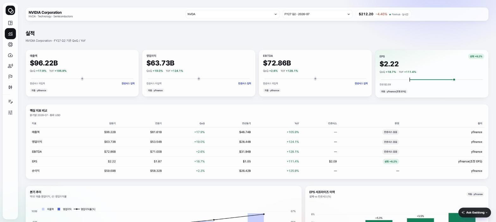</p>

- **4대 지표 카드**: 개요와 같습니다.
- **핵심 지표 비교 표**
  - 열: 지표 · 당분기 · 전분기 · QoQ · 전년동기 · YoY · 컨센서스 · 판정 · 출처
  - 순이익도 함께 나옵니다.
  - 미국은 달러 B(10억)/M(백만), 한국은 원 조/억 단위입니다.
- **분기 추이**: 막대는 매출·영업이익, 선은 영업이익률(오른쪽 축)입니다.
- **EPS 서프라이즈 이력**: 과거 분기마다 실제 EPS가 컨센서스를 몇 % 넘었는지(초록) 또는 밑돌았는지(빨강) 보여줍니다.
- **원본 분기 데이터**(맨 아래 펼치기): 계산에 쓴 원래 숫자 표입니다.

> **EPS 기준**: 컨센서스가 조정(Non-GAAP) EPS 기준이라, 앱도 조정 EPS로 비교합니다. 출처에 `yfinance(조정 EPS)`라고 나옵니다. GAAP EPS는 KPI 화면에서 AI 추출값으로 볼 수 있습니다.

### 2-6. 사업부문

<p align="center">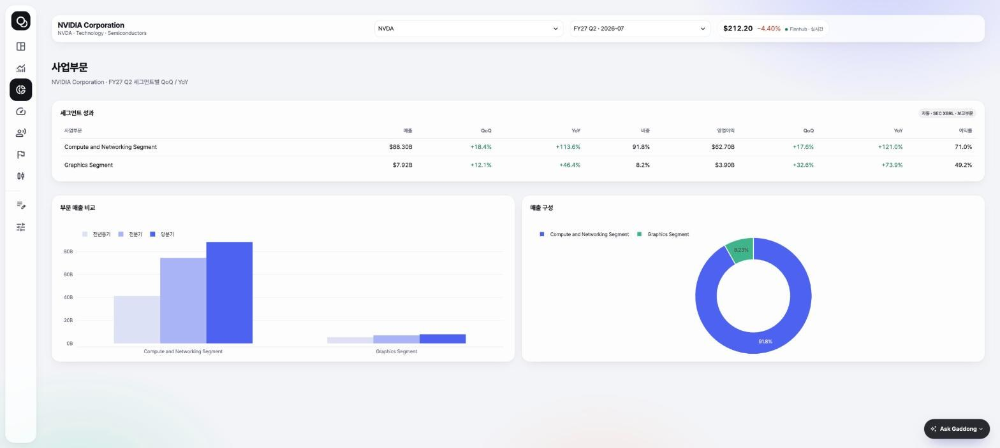</p>

- **세그먼트 성과 표**
  - 열: 사업부문 · 매출 · QoQ · YoY · 비중 · 영업이익 · QoQ · YoY · 이익률
  - QoQ·YoY는 `revenue_prev_q`(전분기)와 `revenue_prev_y`(전년동기) 값이 있어야 계산됩니다. 없으면 `—`로 나옵니다.
  - 위 캡처는 NVDA 10-Q의 XBRL 원본에서 자동으로 채운 값입니다(전분기·전년동기 포함, 출처 배지 `자동 · SEC XBRL · 보고부문`).
- **부문 매출 비교**: 부문마다 전년동기·전분기·당분기 막대를 나란히 보여줍니다.
- **매출 구성**: 부문 매출 비중 도넛입니다.
- **부문 코멘트**: 각 부문의 `note`입니다.
- "전사 합계", "Total" 같은 **합계 행은 자동으로 뺍니다**(비중이 틀어지지 않게).
- **자동 채움**: 분기 보고서의 XBRL 원본에서 부문 숫자를 그대로 읽습니다. 출처 배지가 `자동 · SEC XBRL · 보고부문`/`자동 · DART XBRL · 보고부문`으로 나옵니다.
  - 미국: 10-Q/10-K(`SEC_USER_AGENT` 필요). 전분기·전년동기 값도 이전 보고서에서 함께 채웁니다.
  - 한국: DART 정기보고서(`DART_API_KEY` 필요). 한국 회사는 부문을 *누적값*으로만 공시하는 경우가 많아 직전 보고서 누적과의 차이로 분기 값을 계산합니다.
  - 회사가 부문을 태깅하지 않으면(은행, 일부 코스닥) 비어 있습니다. 부문 대신 *제품·서비스별* 매출만 있으면 그것을 씁니다.
  - 부문 합계는 내부거래 때문에 전사 매출과 다를 수 있습니다(예: 현대차). 합계가 전사의 1.6배를 넘으면 중복 태깅으로 보고 쓰지 않습니다.
- 우선순위: **내 입력 > 공시 XBRL > AI 추출**. AI가 단 부문 코멘트는 XBRL 숫자 옆에 그대로 붙습니다.
- 자동으로 못 채우면 채우는 방법 두 가지가 안내됩니다.
  1. 컨콜 → 보도자료 AI 추출
  2. 입력 관리에서 직접 입력

### 2-7. KPI

<p align="center">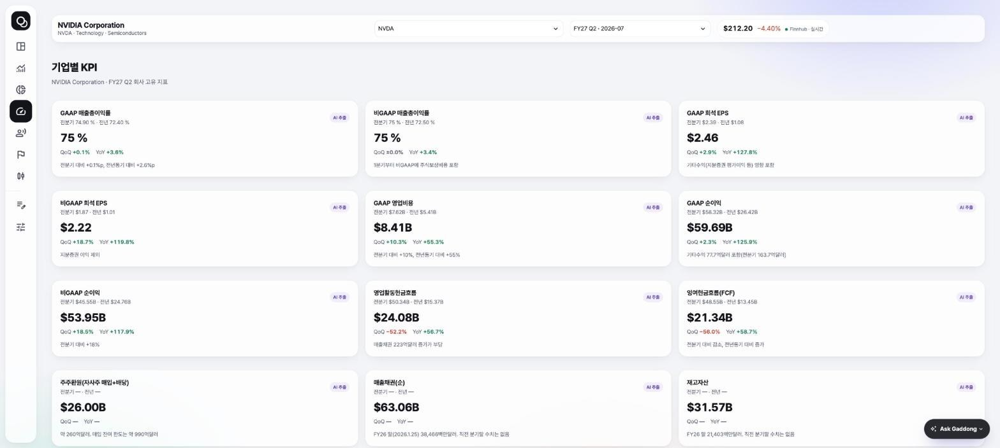</p>

- 회사 고유 지표가 카드로 나옵니다(예: 매출총이익률, FCF, 수주잔고, 가동률).
- 카드 하나에 이름, 전분기·전년 값, 당분기 값, QoQ·YoY, 메모(`note`), 출처가 들어갑니다.
- 단위가 `%`인 지표의 QoQ·YoY는 **변화율(%)**입니다. %p 차이는 메모를 참고하세요.

### 2-8. 컨콜 — 분석 결과 탭

<p align="center">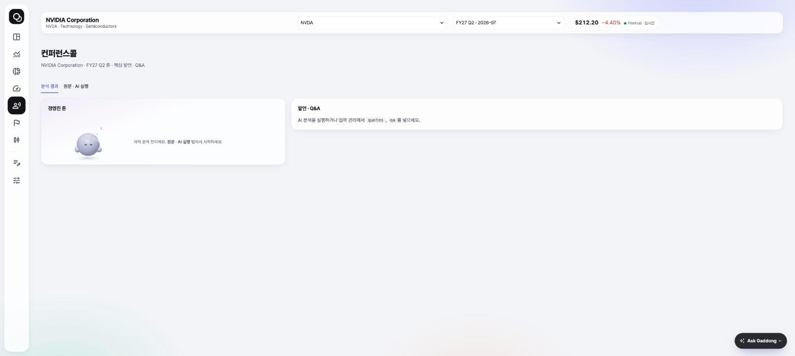</p>

분석 전에는 위 캡처처럼 가똥이 졸고 있고(– – 눈, Zz) 안내만 나옵니다. 분석이 끝나면 톤에 맞춰 기분이 바뀝니다(자신감→뿌듯, 긍정→좋아요, 신중→아쉬워요, 부정→속상해요). 분석 후에는 아래 카드가 채워집니다.

| 카드 | 내용 |
|---|---|
| **경영진 톤** | 톤에 맞춰 움직이는 마스코트, 톤 라벨(자신감·긍정·중립·신중·부정), "전분기 대비 개선/유지/악화/비교불가", −1~+1 톤 막대, 요약 |
| 경영진 감성(AV) | 미국 종목이고 Alpha Vantage 원문이 있으면 CEO·CFO 발언의 감성 점수 평균. 전분기 원문도 받아 두면 전분기 값이 함께 나옵니다. |
| **전분기 대비 달라진 점** | 새로 언급한 것, 빠진 것, 말투가 바뀐 것 3~6개 |
| **CEO · CFO 핵심 발언** | 인용문, 발언자·직함, 왜 중요한지 |
| **Q&A 핵심** | 질문(애널리스트), 답변, 시사점 |

전분기 대비 비교는 **전분기 컨콜을 먼저 분석해 둔 경우**에 더 정확합니다. AI가 전분기 요약을 함께 읽기 때문입니다.

### 2-9. 컨콜 — 원문 · AI 실행 탭

<p align="center">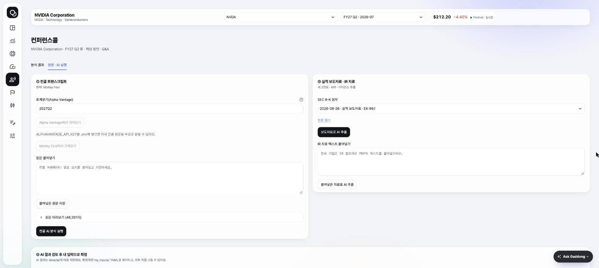</p>

**① 컨콜 트랜스크립트** (왼쪽)

| 단계 | 미국 종목 | 한국 종목 |
|---|---|---|
| 1. 원문 확보 | **회계분기** 칸을 확인합니다. 자동 계산값이고, NVDA FY27 2분기는 `2027Q2`입니다. 그다음 **Alpha Vantage에서 가져오기**를 누릅니다. 키가 없으면 버튼이 회색입니다. | 무료 API가 없습니다. 회사 IR 페이지의 컨콜 녹취록·Q&A 요약을 복사합니다. |
| 2. 붙여넣기(선택) | 다른 곳에서 구한 원문이 있으면 **원문 붙여넣기**에 넣고 **붙여넣은 원문 저장** | 같은 방법 |
| 3. 확인 | **원문 미리보기**를 펼쳐 앞부분 4,000자를 확인합니다. | 같음 |
| 4. 분석 | **컨콜 AI 분석 실행**(1~3분). 끝나면 분석 결과 탭이 채워집니다. | 같음 |

- 받은 Alpha Vantage 원문은 `data/cache/`에 영구 저장되어 같은 분기는 다시 호출하지 않습니다(하루 25회 절약).
- 붙여넣은 원문은 `my_inputs/transcripts/<티커>_<분기말>.txt`에 저장됩니다.
- 원문 출처 우선순위는 **붙여넣은 원문 > Alpha Vantage**입니다. 위쪽 "현재:"에 지금 쓰는 출처가 나옵니다.
- 붙여넣은 원문을 쓰면 Alpha Vantage 발언별 감성 점수는 나오지 않습니다(AI 톤 분석은 정상).

**② 실적 보도자료 · IR 자료** (오른쪽) — 세그먼트·KPI·가이던스·체크포인트 추출

| 미국 종목 | 한국 종목 |
|---|---|
| `SEC_USER_AGENT`가 있으면 **SEC 8-K 첨부** 목록이 나옵니다. 발표일 ±5일 공시가 먼저 보입니다. "실적 보도자료 · EX-99.1"을 고르고 **보도자료로 AI 추출**을 누릅니다. **원문 열기**로 SEC 원문도 볼 수 있습니다. CFO 코멘터리(EX-99.2)도 따로 추출할 수 있습니다. | IR 발표자료 PDF를 열어 전체 선택·복사한 텍스트를 **IR 자료 텍스트 붙여넣기**에 넣고 **붙여넣은 자료로 AI 추출**을 누릅니다. 표가 깨져 보여도 숫자만 들어 있으면 됩니다. |

**③ AI 결과 검토 후 내 입력으로 확정** (아래)

- AI 결과는 `data/ai/`에 따로 저장되고, 바로 화면에 `AI 추출` 배지로 나옵니다. 확정하지 않아도 보입니다.
- **AI 결과를 내 입력으로 저장**을 누르면 AI 결과가 `my_inputs/companies/<티커>/<분기말>.yaml`로 복사됩니다.
  - 내 파일에 **이미 있는 항목은 덮어쓰지 않고**, 비어 있는 항목만 채웁니다.
  - 보도자료와 컨콜을 둘 다 분석했다면 가이던스·체크포인트는 **둘 다 합쳐서** 저장합니다(보도자료 먼저).
  - 금액은 `95.00조`, `$89.00B`처럼 **읽기 쉬운 단위**로 저장되어 바로 고칠 수 있습니다.
  - 그다음 **입력 관리**에서 틀린 숫자를 고치면 됩니다.
- 확정해 두면 나중에 AI를 다시 돌려도 내가 고친 값이 유지됩니다(우선순위 **내 입력 > AI 추출**).

### 2-10. 가이던스 · 카탈리스트

<p align="center">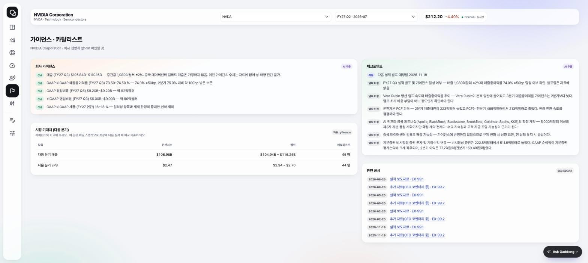</p>

| 카드 | 내용 | 출처 |
|---|---|---|
| **회사 가이던스** | 항목, 기간, 범위(하단~상단, 중간값), 방향 칩(상향/유지/하향/신규/철회/정성적), 메모 | AI 추출 / 내 입력 |
| **시장 기대치 (다음 분기)** | 다음 분기 매출·EPS 컨센서스 평균, 범위, 애널리스트 수. 회사 가이던스와 비교해 보세요. **이 값은 매일 자동 저장되어 다음 실적 때 판정 기준이 됩니다.** | 자동 · yfinance |
| **체크포인트** | `자동` 칩은 다음 실적 발표 예정일입니다. 나머지는 AI가 뽑았거나 내가 넣은 확인 사항입니다. | 자동 + AI + 내 입력 |
| **증권사 시각** | 목표주가 평균, 투자의견, 최근 리포트 제목 | 네이버(켜야 보임, 한국만) |
| **관련 공시** | 최근 공시 8개(링크) | 미국 SEC(`SEC_USER_AGENT` 필요) / 한국 DART(`DART_API_KEY` 필요) |
| **최근 뉴스** | 최근 뉴스 6개(링크) | yfinance |

### 2-11. 주가 반응

<p align="center">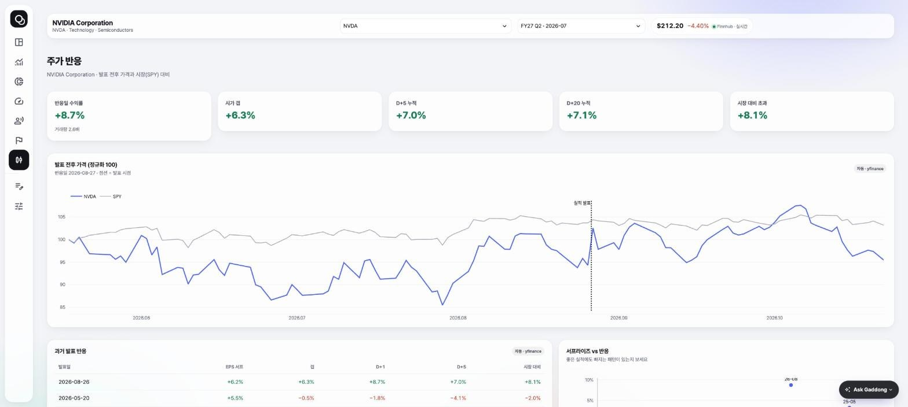</p>

- **위 5개 숫자**
  - 반응일 수익률(옆에 평소 대비 거래량 배수)
  - 시가 갭: 전일 종가 대비 반응일 시가
  - D+5 누적, D+20 누적
  - 시장 대비 초과: 반응일 수익률 − 시장지수 수익률
- **반응일 규칙**
  - 장 마감 후(현지 16시 이후, 한국은 15:30 이후) 발표면 **다음 거래일**이 반응일입니다.
  - 장 전·장중 발표면 **당일**이 반응일입니다.
- **시장지수**: 미국 SPY, 코스피 종목 KOSPI(^KS11), 코스닥 종목 KOSDAQ(^KQ11)
- **발표 전후 가격 (정규화 100)**: 종목(파랑)과 시장지수(회색)를 같은 출발점 100으로 맞춘 선입니다.
- **과거 발표 반응 표**: 과거 발표마다 EPS 서프라이즈와 갭·D+1·D+5·시장 대비 수익률입니다.
- **서프라이즈 vs 반응**: 가로축은 서프라이즈, 세로축은 D+1 수익률입니다. 오른쪽 아래(좋은 실적인데 하락) 점이 많으면 "기대가 이미 주가에 반영된" 종목일 수 있습니다.

### 2-12. 실적 발표 당일 순서 (처음부터 끝까지)

**미국 종목 (예: NVDA)** — `SEC_USER_AGENT`, `ALPHAVANTAGE_API_KEY` 권장

1. **발표 전**(며칠 전이면 충분)에 앱에서 종목을 한 번 엽니다. 다음 분기 컨센서스가 스냅샷으로 저장되어 발표 후 매출 판정에 쓰입니다.
2. 발표 후 앱을 열고 종목을 고릅니다. 실적이 반영되기까지 몇 시간~하루 걸릴 수 있습니다. 반영 전이면 분기 상자에 새 분기가 없습니다.
3. **개요**에서 EPS 판정과 4대 지표를 봅니다.
4. **컨콜 → 원문 · AI 실행**으로 갑니다.
   1. ② **SEC 8-K 첨부**에서 "실적 보도자료 · EX-99.1"을 고르고 **보도자료로 AI 추출**을 누릅니다(약 1분).
   2. ① **Alpha Vantage에서 가져오기**를 누릅니다. 컨콜 원문은 보통 발표 다음 날쯤 올라옵니다. 그다음 **컨콜 AI 분석 실행**을 누릅니다(1~3분).
   3. ③ **AI 결과를 내 입력으로 저장**을 누릅니다.
5. **사업부문·KPI·가이던스** 화면을 보고 숫자를 원문과 대조합니다. 틀리면 **입력 관리**에서 고칩니다.
6. 다음 날 이후 **주가 반응**에서 반응일·D+5를 확인합니다.

**한국 종목 (예: 005930.KS)** — `DART_API_KEY` 권장

1. 발표 **전에** FnGuide·증권사 리포트에서 매출·영업이익 컨센서스를 확인해 **입력 관리**의 `consensus`에 넣어 둡니다. 한국은 지난 분기 컨센서스를 무료로 줄 곳이 없어서, 이 단계가 영업이익 판정의 핵심입니다.
2. 잠정실적 공시 후 앱을 엽니다. DART 키가 있으면 공식 재무제표를 씁니다.
   - 단, 잠정실적은 매출·영업이익만 먼저 나옵니다.
   - 분기보고서가 나오기 전까지는 yfinance 값이 늦게 들어올 수 있습니다.
   - 공식 숫자가 아직 없으면 `actual_override`에 잠정 숫자를 넣으세요.
3. 회사 IR 페이지에서 **실적 발표자료(PDF)**와 **컨콜 녹취·Q&A**를 구합니다.
4. **컨콜 → 원문 · AI 실행**으로 갑니다.
   1. 발표자료 텍스트는 ② **IR 자료 텍스트 붙여넣기**에 넣고 **붙여넣은 자료로 AI 추출**을 누릅니다.
   2. 컨콜 녹취는 ① **원문 붙여넣기**에 넣고 **붙여넣은 원문 저장**을 누른 뒤 **컨콜 AI 분석 실행**을 누릅니다.
   3. ③ **AI 결과를 내 입력으로 저장**을 누릅니다.
5. 이후는 미국과 같습니다.

### 2-13. 입력 관리

<p align="center">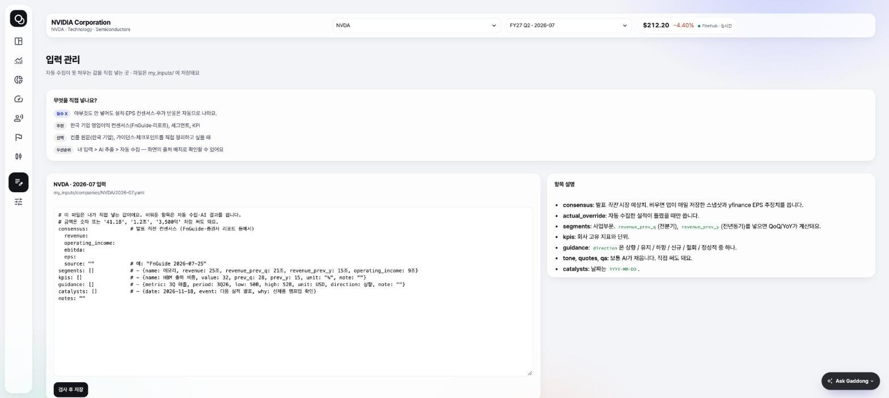</p>

- **편집기**: 지금 상단 바에서 고른 **종목·분기**의 파일을 편집합니다. 편집기 제목 아래에 파일 경로가 나옵니다.
  - 파일이 없으면 빈 템플릿이 나옵니다.
  - 값을 채우고 **검사 후 저장**을 누르면 형식을 검사한 뒤 저장하고, 다른 화면에 바로 반영합니다.
  - 형식이 틀리면 저장하지 않고 이유를 보여줍니다(예: "알 수 없는 항목", "'segments'는 목록이어야 합니다").
- **항목 설명**: 각 항목의 뜻입니다. 자세한 작성법은 [3-4 my_inputs 작성 완전 가이드](#3-4-my_inputs-작성-완전-가이드)를 보세요.
- **관심 종목**(아래): 쉼표로 구분한 티커를 고치고 **관심 종목 저장**을 누릅니다. 순서대로 종목 상자 목록이 되고, 첫 번째가 앱을 처음 열 때의 종목입니다.

### 2-14. 설정

<p align="center">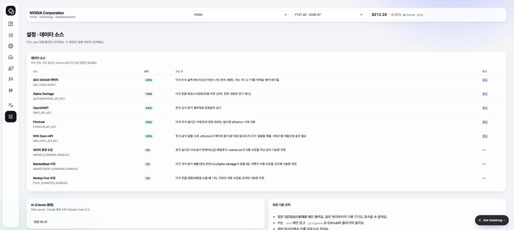</p>

- **데이터 소스 표**: 각 키가 `등록됨`/`미등록`인지, 옵트인 수집(네이버·MarketBeat·Motley Fool)이 `켜짐`/`꺼짐`인지만 보여줍니다. **키 값은 화면에 절대 나오지 않습니다.** **발급** 링크로 가입 페이지에 갈 수 있습니다.
- **AI (Claude 플랜)**: 사용하는 모델과 Claude Code CLI 상태가 나옵니다. **연결 테스트**를 누르면 "연결됨" 같은 짧은 답이 와야 정상입니다.
- **보안 기본 규칙**: 5장의 요약입니다.

### 2-15. Ask Gaddong (AI 질문)

<p align="center">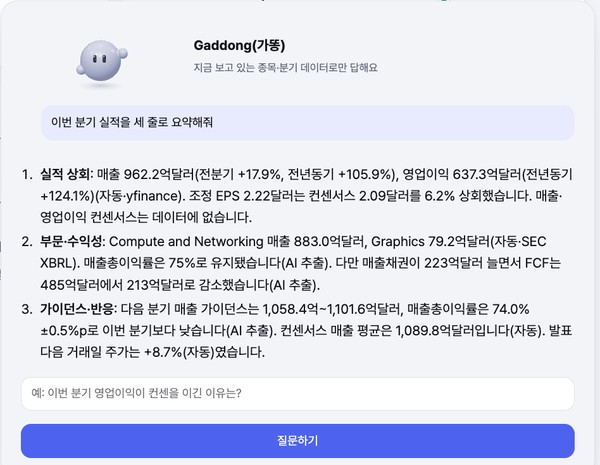</p>

> 위 캡처는 실제 답변입니다. 화면의 숫자(조정 EPS 2.22 vs 컨센 2.09, SEC XBRL 부문 매출, 가이던스와 다음 분기 컨센서스)만 근거로, 항목마다 출처(자동·AI 추출)를 밝혀 답했습니다. 창 위쪽에서 가똥이 손을 흔들어 인사합니다.

1. 오른쪽 아래 **Ask Gaddong**를 누릅니다.
2. 질문을 쓰고 **질문하기**를 누릅니다(최대 1,000자).

- **지금 보고 있는 종목·분기 데이터만** 근거로 답합니다.
  - 근거 데이터: 실적, 컨센서스, 판정, 주가 반응, 다음 분기 컨센서스, 내 입력, AI 추출
  - 데이터에 없는 내용은 없다고 답하고, 숫자에는 출처(자동/내 입력/AI)를 밝힙니다. 투자 권유는 하지 않습니다.
- 질문 예시
  - "이번 분기 영업이익이 컨센을 이긴 이유는?"
  - "가이던스가 시장 기대치보다 높아?"
  - "전분기 대비 톤이 바뀐 부분만 정리해줘"
- 대화는 최근 8개까지 보이고, **새로고침하면 지워집니다**(저장하지 않음).
- 키가 필요 없고, Claude 구독 플랜 사용량을 씁니다.

### 2-16. 모바일·다른 기기에서 보기

- 창 폭이 760~1180px(태블릿·좁은 창)이면 지표 카드와 개요 카드가 2열로 접히고, 상단 바가 두 줄이 됩니다.
- 760px 이하(휴대폰)면 레일이 아래쪽 막대로 바뀌고, 지표 카드는 2×2로 배치됩니다. Ask Gaddong는 아이콘만 남습니다.
- 기본적으로 앱은 **이 컴퓨터에서만** 열립니다. 휴대폰에서 보려면 6장 Tailscale을 따라 하세요.

---

### 2-17. 가똥 마스코트 (3D 캐릭터)

<p align="center"></p>

개요 헤드라인, 컨콜 톤 카드, Ask Gaddong 창의 오브 캐릭터는 상황에 맞춰 표정과 동작이 바뀝니다. 마우스를 따라 보고, 클릭하면 반응합니다.

| 상황 | 기분 | 눈 · 동작 |
|---|---|---|
| 어닝 서프라이즈 | 최고예요 | ★ 별 눈, 점프하며 한 바퀴, 머리 위 별, 반짝이 |
| 컨센서스 상회 | 좋아요 | ^ ^ 웃는 눈, 깡충, 박수 |
| 부합 | 무난해요 | 기본 눈, 끄덕 |
| 하회 | 아쉬워요 | 처진 눈, 손으로 얼굴, 식은땀 |
| 어닝 쇼크 | 헉! | O O 놀란 눈 ↔ > < 질끈, 뒤로 흠칫, ! |
| 컨센서스 없음 | 흠? | 두리번, 돋보기, ? |
| 컨콜 톤 분석 전 | 졸려요 | – – 감은 눈, Zz |
| 톤: 자신감 / 긍정 / 신중 / 부정 | 뿌듯 / 좋아요 / 아쉬워요 / 속상해요 | 톤 색으로 몸이 물든다 |

- 모델: Morphloom(Sceliph, 로컬 3D 에셋 도구)으로 만든 `static/mascot/gaddong.glb`(몸·눈·손·볼·돋보기·별이 이름 있는 부품 11개). 원본은 `static/mascot/morphloom/`에 있습니다.
  - `job.json`: AssemblyIR(형상·재질)과 근거 팩. Morphloom 작업 폴더의 `work/gaddong/`에 두고 `npm run morphloom -- build --job work/gaddong/job.json --out outputs/<새 폴더>`로 다시 빌드합니다.
  - `sources/`: 근거 이미지(대시보드 오브 캡처, 치수를 정한 설계 도면 1px = 1mm). `run-report.json`: 빌드 결과(`review-pass`, 토폴로지·GLB 검증 통과).
  - 애니메이션은 리깅(뼈대)이 아니라 런타임에서 부품을 움직이는 절차적 동작이라, Morphloom 기준의 애니메이션 납품 단계는 아닙니다.
- 런타임: `static/mascot/src/mascot.js`(three.js r179) → `static/mascot/mascot.bundle.js`. 고친 뒤 `THREE_NODE_MODULES=<three가 든 node_modules> scripts/build_mascot.sh`로 다시 빌드합니다.
- WebGL을 못 쓰면 회색 CSS 오브로 대신합니다. 움직임 줄이기(prefers-reduced-motion) 설정이면 깜빡임 정도만 남깁니다.

## 3. 내가 직접 해야 하는 일 vs 자동으로 되는 일

### 3-1. ✅ 자동 (아무것도 안 해도 됨)

- 분기 손익(매출·영업이익·EBITDA·EPS·순이익)과 QoQ/YoY 계산
- EPS 컨센서스 대비 판정(미국·한국), 과거 EPS 서프라이즈 이력
- 실시간/지연 주가, 발표일 전후 주가 반응·시장 대비 초과수익
- 다음 분기 컨센서스(매출·EPS) **매일 스냅샷 저장** → 다음 실적 때 비교 기준으로 자동 사용
- 다음 실적 발표 예정일, 최근 뉴스

### 3-2. 🔑 한 번만 하면 되는 일 (설정)

| 할 일 | 효과 | 소요 |
|---|---|---|
| `.env`에 `SEC_USER_AGENT` 입력 | 미국 실적 보도자료(8-K) 자동 수집 → AI로 세그먼트·가이던스 추출 | 1분 |
| Alpha Vantage 무료 키 | 미국 컨콜 원문 + **과거 분기 매출 컨센서스** | 2분 |
| OpenDART 무료 키 | 한국 공식 분기 재무제표 + 공시 목록 | 5분 (이메일 인증) |
| Claude Code 설치·로그인 | 모든 AI 기능 | 5분 |
| (선택) Finnhub 무료 키 | 미국 실시간 시세 | 2분 |
| (선택) 네이버 수집 켜기 | 한국 실시간 시세·분기 컨센서스(E)·목표주가 | 0분 (본인 판단, 4장 참고) |

### 3-3. 키를 넣으면 화면이 어떻게 달라지나

키는 숫자를 "더 정확하게" 만든다기보다 **빈칸을 채웁니다**. 단, DART는 한국 실적 숫자 자체를 공식 값으로 바꿉니다.

| 화면 · 항목 | 키 없이 | 키를 넣으면 |
|---|---|---|
| 실적 숫자(미국) | yfinance | yfinance가 비운 최근 분기를 **10-Q/10-K 원본**으로 채움(`SEC_USER_AGENT`) |
| 실적 숫자(한국) | yfinance(값이 틀리는 경우 있음: NAVER 영업이익=매출 등) | **DART 공식 재무제표**로 교체(`DART_API_KEY`). EBITDA도 DART 영업이익+감가상각비로 계산. 네이버를 켜면 빈 분기를 네이버 값으로 보완 |
| EPS 판정 | ✅ yfinance | 같음 |
| 매출 판정(미국) | 스냅샷이 쌓인 뒤부터 | **과거 분기도 바로**(`ALPHAVANTAGE_API_KEY`) |
| 매출·영업이익 판정(한국) | 직접 입력 | 네이버를 켜면 다음 분기부터 스냅샷 자동 |
| 컨콜 원문(미국) | 붙여넣기만 | **버튼 한 번**(`ALPHAVANTAGE_API_KEY`) + 발언별 감성 점수. 옵트인 `FOOL_SCRAPING_ENABLED`로 Motley Fool 원문도 가능 |
| 매출 판정(미국, 과거 분기) | 스냅샷이 쌓인 뒤부터 | 옵트인 `MARKETBEAT_SCRAPING_ENABLED`로 최근 8개 분기 매출·EPS 컨센서스 |
| 주가 반응(한국) | yfinance(당일 종가가 다음 날 채워지고 지수 일봉이 빠지는 날이 있음 → 그 날은 `—`) | **KRX 공식 시세**로 빈 날을 채움(`KRX_OPEN_API_KEY`) |
| 사업부문 | AI 추출·직접 입력 | **공시 XBRL에서 자동**(미국 `SEC_USER_AGENT`, 한국 `DART_API_KEY`) |
| 보도자료 → KPI·가이던스(미국) | IR 텍스트 붙여넣기 | **SEC 8-K 자동 목록**(`SEC_USER_AGENT`) |
| 관련 공시 카드 | 안내 문구 | 미국 SEC / 한국 DART 공시 목록 |
| 가격 알약 | 노란 점(지연) | 초록 점(실시간): 미국 `FINNHUB_API_KEY`, 한국 `NAVER_SCRAPING_ENABLED=true` |
| 증권사 시각 카드(한국) | 없음 | 목표주가·투자의견·리포트 제목(네이버) |
| AI 기능 전부 | Claude Code 로그인 필요 | — (키 아님) |

### 3-4. my_inputs 작성 완전 가이드

**무엇을 넣어야 하나**

| 우선도 | 값 | 이유 | 어디서 구하나 |
|---|---|---|---|
| ⭐ 꼭 | 한국 기업 **영업이익(·매출) 컨센서스** | 무료 API가 *지난 분기* 컨센서스를 주지 않음 → 없으면 판정 불가 | FnGuide, 증권사 리포트, 언론 "컨센서스" 기사 |
| 추천 | AI 추출값 검토·수정(세그먼트·KPI·가이던스) | AI는 단위·부호를 틀릴 수 있음 | 보도자료·IR 원문 |
| 추천 | 세그먼트의 전분기·전년동기 값 | QoQ·YoY 계산에 필요. 보도자료에 없으면 AI도 못 채움 | 지난 분기 IR 자료 |
| 선택 | 미국 기업 영업이익·EBITDA 컨센서스 | 무료로 과거값을 구하기 어려움 | 리포트, 뉴스 |
| 선택 | 체크포인트, 메모 | 나만의 관점 | — |
| 드물게 | `actual_override` | 자동 수집 실적이 틀렸거나 아직 없을 때(한국 잠정실적 직후) | 공시 |

**파일 위치와 이름 규칙**

```
my_inputs/
├── watchlist.yaml                         ← 관심 종목 (앱이 자동 관리)
├── companies/
│   ├── NVDA/
│   │   └── 2026-07.yaml                   ← 엔비디아 FY27 2분기
│   └── 005930_KS/
│       └── 2026-06.yaml                   ← 삼성전자 2026년 2분기
└── transcripts/
    └── 005930_KS_2026-06.txt              ← 붙여넣은 컨콜 원문 (앱이 저장)
```

- 폴더 이름은 티커에서 `.`을 `_`로 바꿉니다. `005930.KS` → `005930_KS`
- 파일 이름은 **분기가 끝나는 연-월**입니다. 상단 바 분기 상자 뒤쪽 값(`· 2026-07`)을 그대로 쓰면 됩니다.

| 결산월 | 분기 | 파일 이름 |
|---|---|---|
| 12월(대부분 한국 기업, 애플 제외 다수) | 1Q / 2Q / 3Q / 4Q | `YYYY-03` / `-06` / `-09` / `-12` |
| 1월 말(엔비디아) | FY27 Q1 / Q2 / Q3 / Q4 | `2026-04` / `2026-07` / `2026-10` / `2027-01` |
| 9월 말(애플) | FY26 Q1 / Q2 / Q3 / Q4 | `2025-12` / `2026-03` / `2026-06` / `2026-09` |

- **가장 쉬운 방법**은 앱의 **입력 관리** 화면에서 편집하는 것입니다. 상단 바에서 종목·분기를 고르면 맞는 파일을 자동으로 열고 만듭니다.
- Antigravity에서 파일을 직접 만들어도 됩니다. 저장 후 앱 화면을 새로고침하면 반영됩니다.

**금액 쓰는 법**

| 쓰는 법 | 뜻 |
|---|---|
| `79조`, `1.2조`, `3,500억`, `1조 2,000억` | 원화 |
| `41.1B`, `850M`, `1.2T` | 달러(B=10억, M=백만, T=1조) |
| `96220000000` | 그냥 숫자(통화 단위 그대로) |
| EPS | 그냥 숫자: 미국 `2.09`(달러), 한국 `1250`(원) |
| 비율 | 숫자만 쓰고 `unit: "%"` |

**항목별 형식** (모든 항목은 선택. 필요한 것만 쓰세요)

```yaml
# ① 컨센서스 — 발표 "직전" 시장 예상치
consensus:
  revenue: 79조              # 매출
  revenue_low: 77조          # (선택) 하단 → 스트립의 파란 띠
  revenue_high: 81조         # (선택) 상단
  operating_income: 4.6조    # 영업이익
  operating_income_low: 4.1조
  operating_income_high: 5.2조
  ebitda:                    # 비워 두면 무시
  eps: 1250
  source: "FnGuide 2026-07-05"   # 어디서 봤는지 (출처 배지에 표시)

# ② 실제값 바로잡기 — 자동 수집이 틀렸거나 아직 없을 때만
actual_override:
  revenue: 79.3조
  operating_income: 4.9조
  # 쓸 수 있는 키: revenue, operating_income, ebitda, eps, net_income

# ③ 사업부문 — name만 필수
segments:
  - name: DS(반도체)
    revenue: 33조
    revenue_prev_q: 29조     # 전분기 → QoQ
    revenue_prev_y: 28조     # 전년동기 → YoY
    operating_income: 3.4조
    operating_income_prev_q: 1.9조
    operating_income_prev_y: 6.5조
    note: HBM 출하 증가        # 부문 코멘트
  - name: DX(완제품)
    revenue: 43조
    operating_income: 1.4조
  # ⚠️ "전사 합계" 행은 넣지 마세요(넣어도 화면에서는 자동으로 빠집니다)

# ④ KPI — name, value 필수
kpis:
  - name: HBM 매출 비중
    value: 32
    prev_q: 28
    prev_y: 15
    unit: "%"
    note: 전분기 대비 +4%p

# ⑤ 가이던스
guidance:
  - metric: 3분기 매출
    period: 3Q26
    low: 80조
    high: 84조
    unit: 원
    direction: 상향          # 상향 / 유지 / 하향 / 신규 / 철회 / 정성적
    note: 메모리 가격 상승 반영

# ⑥ 컨콜 톤 — 보통 AI가 채움
tone:
  score: 0.4                 # -1(부정) ~ +1(긍정)
  label: 긍정                # 자신감 / 긍정 / 중립 / 신중 / 부정
  vs_last: 개선              # 개선 / 유지 / 악화 / 비교불가
  summary: 한 문단 요약
  changes:
    - 전분기 대비 달라진 점 1
    - 달라진 점 2

# ⑦ 핵심 발언 — 보통 AI가 채움
quotes:
  - speaker: 홍길동
    role: CFO
    text: "하반기 수요는 공급을 넘어설 것"
    why: 증설 투자 정당화

# ⑧ Q&A — 보통 AI가 채움
qa:
  - analyst: ○○증권
    question: 가격 인상 폭은?
    answer: 한 자릿수 후반 기대
    signal: 마진 개선 여지

# ⑨ 체크포인트
catalysts:
  - date: 2026-10-08         # YYYY-MM-DD, 모르면 비워 두기 → "날짜 미정"
    event: 3분기 잠정실적
    why: HBM 램프업 확인

# ⑩ 자유 메모
notes: |
  여러 줄 메모 가능
```

**자주 하는 실수**

| 증상 | 원인 | 해결 |
|---|---|---|
| "알 수 없는 항목" | 항목 이름 오타(`segment`, `consensus_rev` 등) | 위 10개 이름만 사용 |
| "'segments'는 목록이어야 합니다" | `-` 없이 씀 | 각 줄 앞에 `- ` |
| 값이 화면에 안 나옴 | 파일 이름의 분기가 다름 | 상단 바 분기 상자 뒤쪽 값과 비교 |
| 숫자가 1억 배 틀림 | 단위 누락(`79` → 79원) | `79조`처럼 단위 붙이기 |
| 들여쓰기 오류 | 탭 문자 사용, 칸 수 불일치 | 스페이스 2칸으로 통일 |

**우선순위**: 같은 항목이 여러 곳에 있으면 **내 입력 > AI 추출 > 자동 수집** 순서로 씁니다. 컨센서스는 지표별로 따로 판단합니다. 내가 `operating_income`만 넣으면 매출은 여전히 자동 값을 씁니다.

**지우려면**: 파일에서 그 항목을 지우고 저장하면 다시 AI 추출·자동 값으로 돌아갑니다. 파일 자체를 지워도 됩니다.

> 🔒 `my_inputs/`의 내 파일은 `.gitignore`로 GitHub에 올라가지 않습니다(`README.md`와 `_examples/`만 올라감).

---

## 4. 필요한 API와 등록 방법

모두 무료입니다. 유료 플랜은 쓰지 않습니다. 조사 근거와 대안 비교는 [`docs/API_GUIDE.md`](docs/API_GUIDE.md)에 있습니다.

| 이름 | `.env` 항목 | 필요도 | 무료 한도 | 쓰는 곳 |
|---|---|---|---|---|
| yfinance | (키 없음) | 자동 | 비공식, 과호출 시 일시 차단 | 손익·EPS 추정/실적·발표일·가격·뉴스 |
| SEC EDGAR | `SEC_USER_AGENT` | 미국 권장 | 초당 10회 | 8-K 실적 보도자료·CFO 코멘터리 원문, 10-Q/10-K XBRL(사업부문·빈 분기 보완) |
| Alpha Vantage | `ALPHAVANTAGE_API_KEY` | 미국 권장 | **하루 25회** | 컨콜 트랜스크립트(발언별 감성), 과거 분기 매출·EPS 컨센서스 |
| OpenDART | `DART_API_KEY` | 한국 권장 | 하루 약 2만 회 | 공식 분기 재무제표, 실적·IR 공시, 정기보고서 XBRL(감가상각비→EBITDA, 사업부문) |
| KRX Open API | `KRX_OPEN_API_KEY` | 한국 권장 | 하루 1만 회 | 공식 일별 시세(종가 동시호가 반영)·지수. yfinance 빈 날 보완 |
| Finnhub | `FINNHUB_API_KEY` | 선택 | 분당 60회 | 미국 실시간 시세 |
| 네이버 증권 | `NAVER_SCRAPING_ENABLED` | 선택(옵트인) | — | 한국 실시간 시세, 분기 실적·컨센서스(E), 목표주가, 리포트 제목 |
| MarketBeat | `MARKETBEAT_SCRAPING_ENABLED` | 선택(옵트인) | 종목당 하루 1회 | 미국 과거 8개 분기 매출·EPS 컨센서스 |
| Motley Fool | `FOOL_SCRAPING_ENABLED` | 선택(옵트인) | 버튼 1회당 1건 | 미국 컨콜 원문 |
| Claude 플랜 | (키 없음, CLI 로그인) | AI 기능 | 플랜 사용량 | 톤·발언·Q&A·세그먼트·가이던스·KPI 추출, Ask Gaddong |

### 등록 방법

**SEC_USER_AGENT** — 키가 아닙니다. SEC 정책상 요청자 연락처를 밝혀야 해서 `이름 이메일` 형식으로 적습니다.

```dotenv
SEC_USER_AGENT=Hong Gildong hong@example.com
```

**Alpha Vantage**

1. <https://www.alphavantage.co/support/#api-key> 접속
2. 용도(Investor 등), 이메일 입력 → *GET FREE API KEY*
3. 화면에 나온 키를 `ALPHAVANTAGE_API_KEY=`에 붙여넣기

> 하루 25회 제한이 있어서 앱은 받은 트랜스크립트를 `data/cache/`에 **영구 저장**하고, 컨센서스는 하루 1회만 호출합니다.

**OpenDART**

1. <https://opendart.fss.or.kr> → 오른쪽 위 *인증키 신청/관리* → *인증키 신청*
2. 회원가입(이메일 인증) 후 신청서 작성(사용 용도: 개인 학습·연구)
3. *인증키 신청/관리 → 오픈API 이용현황*에서 40자리 키 복사 → `DART_API_KEY=`에 붙여넣기

**Finnhub (선택)** — <https://finnhub.io/register> 가입 → 대시보드의 *API Key* 복사 → `FINNHUB_API_KEY=`

**KRX Open API (한국 권장)**

1. <https://openapi.krx.co.kr> 회원가입 → *API 인증키 신청* → 발급된 키를 `KRX_OPEN_API_KEY=`에 붙여넣기
2. **서비스 이용신청을 따로 해야 합니다.** *서비스 이용 → 주식/지수* 에서 아래 4개를 신청하고 승인(약 1일)을 기다리세요. 승인 전에는 401이 나오고, 앱은 자동으로 yfinance만 씁니다.
   - 유가증권 일별매매정보 · 코스닥 일별매매정보 · KOSPI 시리즈 일별시세정보 · KOSDAQ 시리즈 일별시세정보

> 왜 필요한가요? yfinance 한국 데이터에는 장 마감 동시호가(15:20~15:30)가 빠져 있어 당일 종가가 다음 날에야 채워지고, 코스피 지수 일봉이 통째로 빠지는 날도 있습니다(2026-10-22 실측). KRX는 그 빈 날만 골라 공식 값으로 채웁니다.

**네이버 증권 수집 (선택, 옵트인)**

네이버 증권은 키 없이 한국 종목의 실시간 시세와 *다음 분기 컨센서스(E)* 를 보여줍니다. 그런데 네이버의 `robots.txt`는 자동 수집을 막고 있고(`Disallow: /`), 이용약관도 무단 수집을 제한할 수 있습니다. 그래서 **기본값은 꺼짐**입니다. 개인 학습 목적에 한해 **본인 판단으로** 켤 수 있습니다.

```dotenv
NAVER_SCRAPING_ENABLED=true
```

켜더라도 종목당 몇 번만 호출하고 결과를 캐시합니다. 끄면 한국 시세는 yfinance(약 15~20분 지연)를 씁니다.

### 왜 한국투자증권(KIS) API는 안 쓰나요?

KIS Open API도 무료이고 실시간 시세를 주지만 **한국투자증권 계좌**가 필요하고 토큰 관리가 복잡합니다. 초보자용 구성에서는 빼고, 네이버 옵트인과 yfinance로 대신했습니다.

### 컨콜 트랜스크립트를 무료로 받을 수 있나요?

| 소스 | 컨콜 원문 |
|---|---|
| yfinance | ❌ 없음 |
| 네이버 증권 | ❌ 없음(리포트 제목·요약만) |
| DART | ❌ 없음(IR 개최 공시만) |
| KIS | ❌ 없음 |
| **Alpha Vantage** | ✅ **미국 기업, 무료 키로 하루 25회** |
| SEC 8-K | △ 보도자료·CFO 코멘터리(일부 회사는 원고 전문) |
| Motley Fool (옵트인) | ✅ 미국 기업 전문. robots.txt는 허용, **약관은 자동 수집 금지** → 기본 꺼짐 |

그래서 **미국은 Alpha Vantage + SEC로 자동**(원하면 Fool 옵트인), **한국은 IR 자료를 붙여넣고 AI로 분석**하는 구조입니다.

**MarketBeat·Motley Fool 수집 (선택, 옵트인)** — 두 사이트 모두 `robots.txt`는 해당 페이지를 막지 않지만, 이용약관이 로봇·스크립트를 통한 자동 수집을 금지하고 개인 1인·비상업 사용만 허용합니다. 그래서 **기본값은 꺼짐**이고, 개인 학습 목적에 한해 본인 판단으로 켤 수 있습니다.

```dotenv
MARKETBEAT_SCRAPING_ENABLED=true   # 과거 분기 매출·EPS 컨센서스 (종목당 하루 1회)
FOOL_SCRAPING_ENABLED=true         # 컨콜 화면의 'Motley Fool에서 가져오기' 버튼 (1회당 1건, 영구 캐시)
```

---

## 5. 보안 기본 규칙

이 프로젝트는 아래를 **기본값**으로 지킵니다. 바꾸지 않는 것을 권장합니다.

1. **키는 `.env`에만 둡니다.** 코드·YAML·문서에 키를 쓰지 않습니다. `.env`는 `.gitignore`에 있어 커밋되지 않습니다. `run.sh`는 `.env`를 만들 때 권한을 `600`(나만 읽기)으로 설정합니다.
2. **화면에 키를 보여주지 않습니다.** 설정 화면은 "등록됨 / 미등록"만 표시합니다(끝자리도 숨김).
3. **에러 메시지에서 키를 지웁니다.** URL의 `apikey=`, `crtfc_key=` 같은 값과 `.env`의 모든 값을 `***`로 바꿉니다(`security.redact`).
4. **내 컴퓨터에서만 열립니다.** `.streamlit/config.toml`이 `127.0.0.1:8765`에만 바인딩합니다. 같은 와이파이의 다른 기기도 접속할 수 없습니다. `0.0.0.0`으로 바꾸지 마세요.
5. **XSRF 보호를 켜고, 사용 통계 전송과 화면의 스택트레이스 노출을 끕니다.**
6. **외부 데이터는 HTML로 넣기 전에 항상 이스케이프합니다.** 트랜스크립트·뉴스 제목 등에 섞인 스크립트가 실행되지 않습니다. AI 답변은 마크다운으로만 렌더링합니다.
7. **AI는 도구 없이 실행합니다.** `claude -p --tools "" --safe-mode --strict-mcp-config`로 파일 읽기·명령 실행·웹 접근 도구를 모두 끕니다. 그래서 트랜스크립트 안에 "파일을 지워라" 같은 문장(프롬프트 인젝션)이 있어도 실행할 수단이 없습니다. 하위 프로세스에서는 `.env`의 키를 환경변수에서 지우고, 빈 임시 폴더에서 실행합니다.
8. **입력을 검증합니다.** 티커·분기 형식을 검사해 `../` 같은 경로 조작을 막고, YAML은 `safe_load`로만 읽습니다(임의 객체 생성 차단).
9. **키를 헤더로 보낼 수 있으면 헤더로 보냅니다**(Finnhub). 쿼리로만 받는 API(Alpha Vantage, DART)는 로그에 URL을 남기지 않습니다.
10. **의존성 버전을 고정합니다**(`requirements.txt`).

키가 유출된 것 같다면 해당 사이트에서 **키를 재발급(폐기)** 하고 `.env`를 새 값으로 바꾸세요.

---

## 6. 밖에서 접속하기: Tailscale 터널

이 앱은 배포용이 아닙니다. 휴대폰이나 다른 컴퓨터에서 보고 싶을 때만 **Tailscale**로 터널을 엽니다. Tailscale은 내 기기끼리만 연결되는 사설 네트워크(VPN)입니다.

### 6-1. 설치·로그인 (한 번만)

1. <https://tailscale.com/download> 에서 **앱을 실행하는 컴퓨터**와 **접속할 기기**(휴대폰 등) 모두에 설치합니다.
2. 두 기기에서 **같은 계정**으로 로그인합니다.
3. 관리 콘솔 <https://login.tailscale.com/admin/dns> 에서 **MagicDNS**와 **HTTPS Certificates**를 켭니다(`serve`가 HTTPS 주소를 만들 때 필요).

### 6-2. 내 기기에서만 보기 — `tailscale serve` (권장)

앱을 평소처럼 실행한 상태(`./run.sh`)에서 **다른 터미널**을 열고:

```bash
tailscale serve --bg 8765
```

출력에 `https://<컴퓨터이름>.<tailnet이름>.ts.net` 주소가 나옵니다. **내 Tailscale 계정에 로그인한 기기에서만** 이 주소로 접속할 수 있습니다.
앱은 계속 `127.0.0.1`에만 열려 있고, Tailscale이 HTTPS로 안전하게 전달해 줍니다. 그래서 설정을 바꿀 필요가 없습니다.

```bash
tailscale serve status     # 현재 열린 주소 확인
tailscale serve reset      # 터널 닫기
```

> Windows에서는 `tailscale` 명령이 PATH에 없으면 `"C:\Program Files\Tailscale\tailscale.exe" serve --bg 8765`처럼 전체 경로로 실행하세요.
> Tailscale 1.52 이전 버전은 명령 문법이 다릅니다. `tailscale version`으로 확인하고 최신으로 업데이트하세요.

### 6-3. ⚠️ 공개 인터넷에 열기 — `tailscale funnel` (비권장)

```bash
tailscale funnel --bg 8765
```

이 명령은 **인터넷의 누구나** 주소만 알면 접속하게 만듭니다. 이 앱에는 **로그인 기능이 없어서**, 접속한 사람이 내 입력 데이터를 보고 수정할 수 있고, Ask Gaddong로 **내 Claude 플랜 사용량을 쓸 수 있습니다**. 꼭 필요하면 잠깐만 열고 `tailscale funnel reset`으로 바로 닫으세요. 스터디원과 공유하려면 funnel 대신 상대를 내 tailnet에 초대(*Share node*)하는 방식을 권장합니다.

---

## 7. 폴더 구조

```text
gaddong/
├─ app.py                     # 진입점: 레일·상단 바·페이지 라우팅·코파일럿
├─ run.sh / run.bat           # 원클릭 실행 스크립트
├─ requirements.txt           # 버전 고정 의존성
├─ .env.example               # 키 템플릿 (.env로 복사해서 사용, .env는 커밋 금지)
├─ .streamlit/config.toml     # 127.0.0.1:8765 고정, 보안 설정, 테마
├─ static/fonts/              # Pretendard 웹폰트 (OFL 라이선스)
├─ static/mascot/             # 가똥 마스코트: gaddong.glb(모델), mascot.bundle.js(런타임), src/(원본), morphloom/(3D 모델 원본 IR·근거 이미지·빌드 리포트)
├─ gaddong/
│  ├─ config.py               # .env 로딩, 키 목록
│  ├─ security.py             # 입력 검증·키 마스킹·HTML 이스케이프
│  ├─ service.py              # 소스 우선순위 병합 + 캐시 (화면은 이것만 호출)
│  ├─ manual.py               # my_inputs/ 읽기·쓰기, AI 결과 병합
│  ├─ ai.py                   # Claude Code CLI 호출 (도구 없음, 구조화 JSON)
│  ├─ providers/              # yfinance · DART · SEC · XBRL 파서 · KRX · Alpha Vantage · Finnhub · 네이버 · MarketBeat · Fool
│  ├─ analysis/               # QoQ/YoY·판정, 컨센서스 스냅샷, 주가 반응
│  └─ ui/                     # 테마 CSS, 카드·스트립·오브 컴포넌트, 셸, mascot.py(3D 마스코트)
├─ views/                     # 화면 9개
├─ my_inputs/                 # ✍️ 내가 직접 넣는 값 (README·예시만 커밋)
├─ data/                      # 🤖 자동 캐시·스냅샷·AI 결과 (커밋 안 함)
├─ docs/API_GUIDE.md          # API 조사 결과와 근거
└─ tests/                     # pytest
```

---

## 8. 문제 해결 (FAQ)

**`command not found: python3` / `'py'은(는) 내부 또는 외부 명령...`**
Python이 설치되지 않았거나 PATH에 없습니다. 1-3 ②를 다시 하세요. Windows는 "Add python.exe to PATH" 체크가 핵심입니다.

**브라우저에 "사이트에 연결할 수 없음"**
터미널에서 앱이 실행 중인지 확인하세요. 포트 8765를 다른 프로그램이 쓰고 있다면 그 프로그램을 끄세요. 확인 명령: Mac `lsof -i :8765`, Windows `netstat -ano | findstr 8765`.

**"분기 실적 데이터를 찾지 못했습니다"**
티커를 확인하세요. 한국은 `.KS`/`.KQ`를 붙여야 합니다. yfinance가 일시적으로 막혔다면(`Too Many Requests`) 몇 분 뒤 다시 시도하세요.

**AI 버튼이 비활성 / "Claude Code CLI를 찾지 못했습니다"**
1-3 ③을 하고 **터미널을 새로 연 뒤 앱을 다시 실행**하세요. 그래도 안 되면 `which claude`(Windows `where claude`)로 나온 경로를 `.env`의 `CLAUDE_BIN=`에 넣으세요.

**AI 분석이 "Claude CLI 오류"**
터미널에서 `claude`를 한 번 실행해 로그인이 살아 있는지 확인하세요. 플랜 사용량 한도에 걸렸을 수도 있습니다.

**Alpha Vantage "호출 한도에 도달"**
무료는 하루 25회입니다. 내일 다시 시도하세요. 이미 받은 원문은 저장돼 있어 다시 호출하지 않습니다.

**매출/영업이익 카드에 "컨센서스 없음"**
과거 분기의 매출·영업이익 컨센서스는 무료로 구하기 어렵습니다. ① 미국은 Alpha Vantage 키를 넣으면 매출이 채워집니다. ② 앱을 실적 발표 **전에** 한 번 열어 두면 다음 분기 컨센서스가 스냅샷으로 저장됩니다. ③ **입력 관리**에서 `consensus`를 직접 넣을 수 있습니다.

**한국 시세가 지연돼요**
yfinance의 한국 시세는 약 15~20분 지연됩니다. 실시간이 필요하면 4장의 네이버 옵션을 참고하세요.

**Tailscale 주소로 열면 화면이 계속 연결 중**
`tailscale serve status`로 8765가 연결돼 있는지, 앱이 실행 중인지 확인하세요. 회사·학교 네트워크가 WebSocket을 막는 경우도 있습니다.

---

## 9. 개발자용 메모

```bash
source .venv/bin/activate
pytest -q                    # 네트워크 없이 도는 단위 테스트 (계산·보안 규칙)
streamlit run app.py         # http://127.0.0.1:8765
```

- 화면(`views/`)은 `service.py`만 부릅니다. 새 데이터 소스는 `providers/`에 추가하고 `service.py`에서 우선순위를 정하세요.
- 외부 문자열을 HTML에 넣을 때는 반드시 `security.esc()` 또는 `components.card()`를 거치세요.
- 디자인 토큰은 `gaddong/ui/theme.css`의 `:root` 한 곳에 있습니다. 디자인 결정 기록은 `DESIGN.md`, 제품 정의는 `PRODUCT.md`에 있습니다.
- 커밋 전 점검: `git status`에 `.env`, `my_inputs/companies`, `data/`가 보이면 안 됩니다.

### 라이선스

코드: MIT. 폰트: Pretendard (SIL Open Font License 1.1, `static/fonts/LICENSE-Pretendard.txt`). 마스코트 런타임에 포함된 three.js: MIT (`static/mascot/LICENSE-three.txt`).
데이터는 각 제공자의 이용약관을 따릅니다. 개인 학습·연구 용도로 사용하세요.
